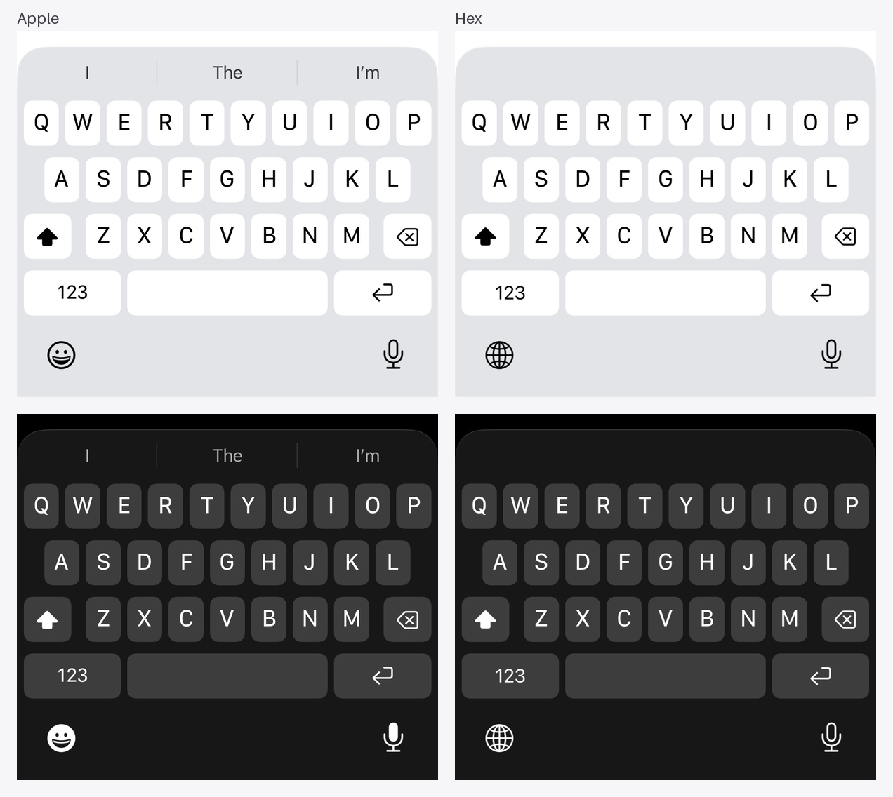
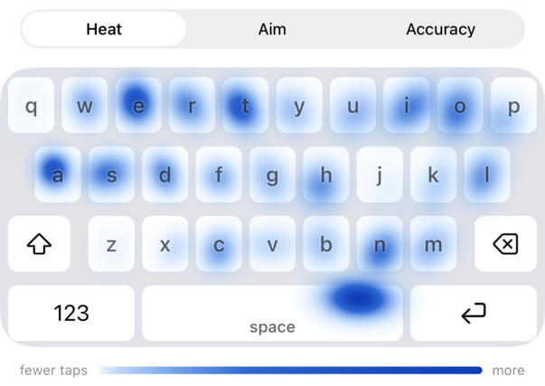
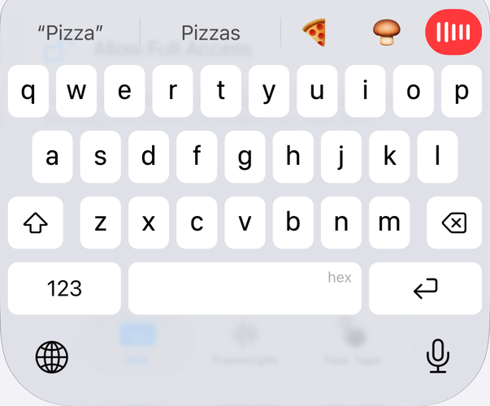

# Hex Keyboard

**A keyboard that feels like Apple's, and learns where you tap.**

Every key matches Apple's keyboard, down to the pixel and the haptic. Hex learns where each of your taps really lands, so it fixes more typos and leaves the words you meant alone.

Open source, for iPhone and iPad on iOS 26 and later. Type with its engine in your browser at [hex-keyboard.vercel.app](https://hex-keyboard.vercel.app).

Apple's keyboard on the left, Hex on the right, in the same simulator:



## It feels like Apple's

Layouts, key sizes, pop-ups, accents, the space bar cursor and the suggestion bar are measured against Apple's keyboard in the same simulator, on every iPhone and iPad size, in light and dark. The haptics play at the strength Apple's keyboard uses, read off a real iPhone. Settings have Apple's names and defaults, and your Text Replacements still work.


## It learns where you tap

Each key remembers where your thumb really lands, from the words you keep and the letters you fix. If your grip changes, it catches up within a few taps. Autocorrect reads every tap with that in mind, and it only changes a word you spelled right when your taps fit another word better.

A test types 500 phrases twice with off-target thumbs. A keyboard that takes the nearest key and corrects with Apple's spell checker gets 85% of words right; Hex gets 97.6%. The numbers and how they're measured are in [PROGRESS.md](PROGRESS.md).

The suggestion bar guesses your next word from the two before it, and from what you usually type.

The Hex app shows what it learned: a heat map of where your thumbs press, where each key's taps land, and the keys you miss most.

<picture>
  <source media="(prefers-color-scheme: dark)" srcset="docs/taps-dark.png">
  
</picture>

## Talk instead of typing

Tap the mic beside the suggestions. iOS doesn't let keyboards use the microphone, so the first time Hex opens its app to start listening, then goes back to your app while you keep talking. The app can then keep the mic on for as long as you pick, and while it's on, the mic starts and stops dictating right there, in any app; hold it to turn the mic off. What you say is turned into text on the iPhone with Apple's speech model, and every transcript is saved in the Hex app.

<picture>
  <source media="(prefers-color-scheme: dark)" srcset="docs/voice-dark.png">
  
</picture>

## Emoji

Type a word like "pizza" and its emoji shows up in the suggestion bar; tap it to swap the word for it. For every emoji, the globe takes you to Apple's emoji keyboard, straight there when Hex and Emoji are your only keyboards.

## Sources

A source is a web service you plug into the keyboard. Hex tells it the text of the field you're typing in, in any app, and it can answer with a hint that shows above the keys: a tone check before you send a text, a reminder, anything it can work out from what you're writing. You add one in the Hex app, or by tapping the link it gives you. The API is one JSON request and answer, in [docs/sources.md](docs/sources.md). [`sources/record.ts`](sources/record.ts) is one you can run yourself: it keeps a log of every message you send.

## Also

- One-handed keyboard: hold 123 and slide left or right.
- Hold the space bar and slide to move the cursor, hold delete to erase whole words, flick down on iPad keys for their second character.
- Return, email, URL and search fields get the keys Apple gives them.
- Hex only goes online to reach the sources you add. Without one, nothing you type or say leaves your iPhone.

Not built yet: swipe typing, and languages other than English.

## Install

Hex isn't on the App Store, so you build it yourself.

On a Mac, with Xcode and [XcodeGen](https://github.com/yonaskolb/XcodeGen):

```sh
xcodegen generate
open HexKeyboard.xcodeproj
```

Put your team in `Config/Team.xcconfig` (`DEVELOPMENT_TEAM = <your team ID>`) and run the `Hex` scheme. On Linux, `scripts/phone` builds and installs it with [xtool](https://github.com/xtool-org/xtool); [AGENTS.md](AGENTS.md) has the details. The app and App Group IDs are Hex's own (`com.shahidy.hexkeyboard`), so a different team may need to swap in its own.

Then on the phone: Settings › General › Keyboard › Keyboards › Add New Keyboard… › Hex, and turn on Allow Full Access. Hex needs it for haptics, voice, Your Taps and sources.

## How it's built

| Path | What |
| --- | --- |
| `Packages/HexKeyboard/Sources/KeyboardCore` | Everything the keyboard does: layouts, typing, autocorrect, the tap model, emoji search. Pure Swift with no Foundation or UIKit, so it also runs in the browser as WebAssembly. Unit tested. |
| `Packages/HexKeyboard/Sources/KeyboardUI` | Draws the keys, handles touches and haptics, and talks to the app. |
| `Keyboard/` | The keyboard extension. |
| `App/` | The Hex app: setup and settings, voice typing, Transcripts and Your Taps. |
| `web/` | The browser demo. |
| `UITests/` | Types through the real keyboard in the simulator. |

Tests:

```sh
cd Packages/HexKeyboard
xcodebuild test -scheme HexKeyboard-Package -destination 'platform=iOS Simulator,name=iPhone 17'
```

[AGENTS.md](AGENTS.md) explains the design and the scripts; [PROGRESS.md](PROGRESS.md) is the build log, with every measurement.

## License

MIT. See [LICENSE](LICENSE).
